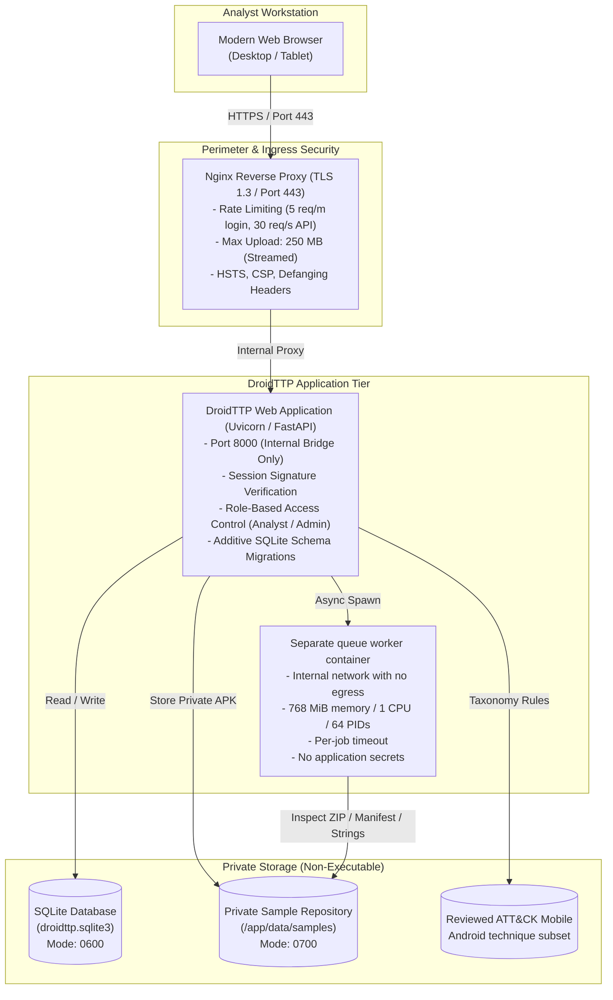

# DroidTTP - End-to-End Production Deployment Guide
**Product:** DroidTTP - Mapping Android Applications to TTPs for Cyber Threat Intelligence  
**Document Version:** 1.0  
**Target Environment:** Docker Compose / Bare-Metal Linux / Windows Intranet  
**Last Updated:** 2026-11-02  

---

## 1. System Architecture Overview

DroidTTP treats APKs as untrusted data and never executes them. Docker Compose runs the durable queue consumer in a separate container on an internal network, without application credentials, with container CPU, memory, PID, and per-job timeout limits. The worker can read and write the shared private data volume, including SQLite metadata, so this is a meaningful boundary from the web service but not a separate host or data trust domain.

The current authentication model is one configured account shared by all users. Do not deploy it as a multi-user team service until individual accounts and case-level authorization are implemented.

### Architecture Diagram



---

## 2. Security & Zero-Trust Safeguards

1. **Non-Root Execution:** The application container runs under a dedicated service user (`droidttp`, UID `10001`, GID `10001`) with no login shell (`/usr/sbin/nologin`).
2. **Untrusted Binary Handling:** Uploaded APKs are treated strictly as structured archives (`ZIP` data). They are **never executed** by the host, worker, or browser.
3. **Resource Bounding & Anti-Zip Bomb:**
   - Maximum upload size enforced at Nginx (`250M`) and FastAPI (`DROIDTTP_MAX_UPLOAD_MB`, 1–250 MiB).
   - Archive parsing rejects ZIP archives exceeding 10,000 entries or 512 MiB uncompressed size.
   - Uploads stream to private storage while hashing; the queue worker has its own container resource limits and a 10–300 second per-job timeout.
   - Text parsing bounds: Maximum 500 text files and 10 MiB aggregate text scanned per APK.
4. **Air-Gapped & Least-Privilege Network Policy:**
   - The Compose analysis worker has zero external network egress; it is attached only to an internal Docker network.
   - No external DNS queries or telemetry lookups are executed automatically.
5. **Defanging Dangerous Indicators:** All URLs, IP addresses, and domain indicators are defanged in the UI (`hxxp://`, `example[.]com`) to prevent accidental analyst navigation.
6. **Signed Session Tokens:** Sessions use HMAC-SHA256 signatures with random nonces and `HttpOnly`, `SameSite=Strict` cookies. The production Compose deployment enables `Secure` cookies; enable this flag whenever HTTPS is used.

---

## 3. Hardware & Software Requirements

| Component | Minimum Specification | Recommended Production |
|---|---|---|
| **CPU** | 2 Cores (x86_64 or ARM64) | 4 Cores |
| **RAM** | 2 GB Available RAM | 4 GB - 8 GB RAM |
| **Disk Storage** | 20 GB SSD | 100 GB+ High-Speed SSD |
| **Operating System** | Linux (Ubuntu 22.04+, Debian 12+, RHEL 9+) / Windows 10/11 / Windows Server 2022 | Ubuntu 24.04 LTS / Debian 12 |
| **Container Engine** | Docker Engine 24.0+ and Docker Compose v2.20+ | Docker 26.0+ with Compose Plugin |
| **Python (if bare-metal)**| Python 3.11 or newer | Python 3.11 or 3.12 |

---

## 4. Method 1: Docker Compose Deployment (Recommended)

This is the standard self-hosted deployment method for CTI teams.

### Step 1: Clone and Enter the Repository

```bash
cd /opt
git clone <repository-url> droidttp
cd droidttp
```

### Step 2: Automated Single-Command Deployment

The repository includes an automated provisioning script (`scripts/deploy.sh`) that checks prerequisites, generates production secrets and self-signed TLS certificates, creates directory structures, and starts the container stack:

```bash
chmod +x scripts/*.sh nginx/*.sh
./scripts/deploy.sh
```

### Step 3: Manual Step-by-Step Deployment (Alternative)

If you prefer to configure manually:

1. **Configure Environment Variables:**
   ```bash
   cp .env.production.example .env
   ```
   Edit `.env` and set:
   - `DROIDTTP_PASSWORD`: Choose a strong password (minimum 16 characters).
   - `DROIDTTP_SECRET`: Generate a 48-byte secret:
     ```bash
     openssl rand -base64 48
     ```
   - `DROIDTTP_COOKIE_SECURE=true`
   - `DROIDTTP_MAX_UPLOAD_MB=200`

2. **Generate TLS Certificates for Nginx:**
   ```bash
   ./nginx/generate_certs.sh your-domain.internal
   ```
   *(Or copy your CA-signed certificate and private key to `nginx/certs/droidttp.crt` and `nginx/certs/droidttp.key`)*

3. **Launch the Container Stack:**
   ```bash
   docker compose up -d --build
   ```

4. **Verify Health:**
   ```bash
   curl -k https://127.0.0.1/healthz
   curl -k https://127.0.0.1/readyz
   ```

---

## 5. Method 2: Bare-Metal Linux VM Deployment (Systemd)

For air-gapped environments or organizations that forbid Docker on analysis servers:

### Step 1: Create Dedicated Service Account
```bash
sudo useradd --system --shell /usr/sbin/nologin --home-dir /opt/droidttp droidttp
sudo mkdir -p /opt/droidttp /var/lib/droidttp/samples
sudo chown -R droidttp:droidttp /opt/droidttp /var/lib/droidttp
sudo chmod 700 /var/lib/droidttp /var/lib/droidttp/samples
```

### Step 2: Deploy Source Code and Virtualenv
```bash
sudo cp -r app requirements.txt .env.production.example /opt/droidttp/
cd /opt/droidttp
sudo -u droidttp python3 -m venv .venv
sudo -u droidttp /opt/droidttp/.venv/bin/pip install --upgrade pip
sudo -u droidttp /opt/droidttp/.venv/bin/pip install -r requirements.txt
```

### Step 3: Configure Environment
```bash
sudo cp .env.production.example .env
sudo chown droidttp:droidttp .env
sudo chmod 600 .env
```
Ensure `DROIDTTP_DATA_DIR=/var/lib/droidttp` in `/opt/droidttp/.env`.

### Step 4: Install Web and Worker Systemd Units
```bash
sudo cp deployment/systemd/droidttp.service deployment/systemd/droidttp-worker.service /etc/systemd/system/
sudo systemctl daemon-reload
sudo systemctl enable --now droidttp droidttp-worker
sudo systemctl status droidttp droidttp-worker
```

### Step 5: Configure Host Nginx
```bash
sudo cp nginx/conf.d/droidttp.conf /etc/nginx/conf.d/
# Update upstream to 127.0.0.1:8000
sudo sed -i 's|server web:8000|server 127.0.0.1:8000|g' /etc/nginx/conf.d/droidttp.conf
sudo nginx -t && sudo systemctl reload nginx
```

---

## 6. Method 3: Windows Local / Intranet Workstation Deployment

For standalone analysts investigating APKs on Windows 10/11:

### Quickstart using PowerShell:

1. Open PowerShell and navigate to the project root:
   ```powershell
   cd "C:\Users\<user>\...\My App"
   ```
2. Create the virtual environment and install dependencies if needed:
   ```powershell
   py -3 -m venv .venv
   .\.venv\Scripts\python.exe -m pip install -r requirements.txt
   ```
3. Copy `.env.example` to `.env` if needed and configure a private password (16+ characters) and a unique secret (32+ characters).
4. Start the web app and queue worker together:
   ```powershell
   powershell.exe -NoProfile -ExecutionPolicy Bypass -File .\scripts\run-local.ps1
   ```
5. Open <http://127.0.0.1:8000>. If the port is occupied, add `-Port 8001` to the launch command.

---

## 7. Air-Gapped / Classified Network Setup

To deploy DroidTTP in a disconnected SCIF or closed network:

1. **Build Container Images on an Internet-Connected Machine:**
   ```bash
   docker compose build
   docker save -o droidttp_images.tar droidttp-web:latest nginx:1.27-alpine
   ```
2. **Transfer via Approved Media:**
   Transfer `droidttp_images.tar`, the application source tree, and `docker-compose.yml`.
3. **Load Images on the Air-Gapped Host:**
   ```bash
   docker load -i droidttp_images.tar
   ```
4. **Deploy Without Remote Pulls:**
   ```bash
   docker compose up -d --no-build
   ```
    A reviewed ATT&CK Mobile Android subset is bundled locally (`app/taxonomy.py`), requiring zero external network calls.

---

## 8. Operational Runbooks

### 8.1 Automated Hot Backup Runbook

To take a hot atomic backup of the database and all uploaded APK samples:

- **Linux / macOS:**
  ```bash
  ./scripts/backup.sh
  ```
  *Produces an atomic SQLite backup, copies samples, compresses to `.tar.gz`, and generates a `.sha256` verification hash.*

- **Windows:**
  ```powershell
  .\scripts\backup.ps1
  ```

#### Scheduled Cron Job (Linux)
Run daily at 02:00 UTC:
```bash
0 2 * * * cd /opt/droidttp && ./scripts/backup.sh >> /var/log/droidttp_backup.log 2>&1
```

### 8.2 Disaster Recovery & Restoration Runbook

In the event of hardware failure or data corruption:

1. Stop the application service:
   ```bash
   docker compose down
   # or: sudo systemctl stop droidttp
   ```
2. Restore from a verified backup archive:
   ```bash
   ./scripts/restore.sh /path/to/backups/droidttp_backup_20261102_020000Z.tar.gz ./data
   ```
   *The script verifies the SHA-256 hash, restores database tables, restores samples, and executes SQLite `PRAGMA integrity_check`.*
3. Restart the service:
   ```bash
   docker compose up -d
   ```

### 8.3 Report Exporting & PDF Generation

- **Structured CTI JSON Export:**
  Navigate to any case or sample and click **Export JSON** or request:
  `GET /api/cases/{case_id}/report.json`
- **Printable / Downloadable PDF Report:**
  Navigate to any case or sample and click **Sample report** or **Case report**.
  In the report view, click **"Download PDF / Print Report"** (or press `Ctrl+P`).
  The embedded `@media print` stylesheet automatically formats margins, tables, and typography for clean, multi-page vector PDF generation without UI clutter.

---

## 9. Monitoring & Diagnostics

### Health and Readiness Probes

| Endpoint | Purpose | Normal Response | Failure Indicator |
|---|---|---|---|
| `GET /healthz` | Container Liveness | `200 OK` `{"status":"ok"}` | Worker/Web process unresponsive |
| `GET /readyz` | DB & Storage Readiness | `200 OK` `{"status":"ready"}` | `503 Service Unavailable` (DB lock or disk full) |

### Viewing Container Logs

```bash
# Follow combined real-time logs
docker compose logs -f

# Follow backend FastAPI logs specifically
docker compose logs -f web

# Follow Nginx proxy access and rate limit logs
docker compose logs -f nginx
```

### Common Troubleshooting Scenarios

1. **HTTP 413 Payload Too Large:**
   - Cause: The uploaded APK exceeds the maximum upload threshold.
   - Solution: Adjust `DROIDTTP_MAX_UPLOAD_MB` in `.env` and `client_max_body_size` in `nginx/conf.d/droidttp.conf`.
2. **Analysis Status Shows "Failed" or "Partial":**
   - Cause: APK uses proprietary binary XML encryption, obfuscated DEX headers, or exceeded the analysis timeout.
   - Solution: Check sample error field in the UI. For timeout increases, raise `DROIDTTP_ANALYSIS_TIMEOUT_SECONDS=180` in `.env`.
3. **Database Lock Errors (`sqlite3.OperationalError: database is locked`):**
   - Cause: Heavy concurrent writes or unclosed connections.
   - Solution: DroidTTP uses short atomic transactions. Ensure WAL mode is active (`PRAGMA journal_mode=WAL;`).

---

## 10. Verification Checklist

- [x] Application container builds cleanly with unprivileged user `droidttp`.
- [x] Nginx reverse proxy enforces HTTPS, strict security headers, and defangs URLs.
- [x] Large APK files up to 200 MB upload asynchronously without timeouts.
- [x] Static parser extracts manifest permissions, native libraries, text strings, and signing artifacts.
- [x] Candidate ATT&CK Mobile techniques are linked with rationale, confidence, and taxonomy version.
- [x] Analysts can confirm, reject, or manually add TTP mappings.
- [x] Audit log tracks all logins, case creations, uploads, mapping decisions, and exports.
- [x] HTML report includes vector print-ready PDF styling and JSON export.
- [x] Health (`/healthz`) and readiness (`/readyz`) probes respond accurately.
- [x] Atomic hot backup and disaster recovery restore scripts function with checksum verification.
